  

# 🚀 Awesome Messaging Automation & iMessage SDK 💬

  
  
  
  
  

---

## 📌 Top Messaging Automation & iMessage SDK Ecosystem

> **A curated showcase of leading SaaS platforms and top open-source projects for programmable iMessage SDKs, SMS/RCS gateways, Matrix bridges, omnichannel chat workflows, and autonomous messaging AI agents.**

Are you looking to automate iMessage and SMS workflows, connect Apple Messages to cross-platform matrix clients (`BlueBubbles`, `mautrix-imessage`), build programmatic AppleScript/SQLite `chat.db` bots, deploy self-hosted Android SIM-card SMS gateways, or empower LLM agents (Claude Code, Cursor, OpenClaw) with two-way conversation capabilities? This guide covers the full spectrum from carrier-grade enterprise APIs to developer-first self-hosted tools.

---

## 📑 Table of Contents
- [📊 Sector Overview & Market Dynamics](#-sector-overview--market-dynamics)
- [☁️ SaaS & Hosted Messaging Platforms](#️-saas--hosted-messaging-platforms)
- [💻 Open-Source Repositories & SDKs](#-open-source-repositories--sdks)
- [🛠️ Architectural Blueprints & Stacks](#️-architectural-blueprints--stacks)
- [🤝 How to Contribute](#-how-to-contribute)
- [💖 Support](#-support)
- [📈 Star History](#-star-history)
- [⚠️ Disclaimer](#️-disclaimer)

---

## 📊 Sector Overview & Market Dynamics

The global cloud communication platform (CPaaS) and enterprise messaging market is valued at approximately **$16.5 billion in 2024–2025** and is projected to surpass **$45 billion by 2030** at an annual growth rate (CAGR) of over 18%. 

The sector is **moderately fragmented**: a handful of hyperscale telecom aggregators (Twilio, Sinch, Infobip, Bird) dominate standard global carrier SMS/MMS routes, while the conversational iMessage, RCS, and AI agent automation segment remains highly specialized and distributed among niche API innovators, sovereign self-hosted open-source gateways, and reverse-engineered bridge ecosystems.

---

## ☁️ SaaS & Hosted Messaging Platforms

The following hosted platforms provide developer APIs, omnichannel business messaging dashboards, and conversational automation workflows. Table entries are sorted in descending order by enterprise scale (annual revenue / valuation).

| 🏢 Platform | 💰 Starting Tier Pricing | 🎁 Free Tier Limit / Trial Limit | 📈 Scale (Revenue / Valuation) | 📝 Highlights & Core Capabilities |
| :--- | :--- | :--- | :--- | :--- |
| **[Twilio Messaging](https://twilio.com)** | **$0.0079** per SMS sent/received; Phone numbers from **$1.15/month** | **$15.50 free trial credit** valid for SMS, WhatsApp, and voice testing | **$4.15B+ Annual Revenue** (NYSE: TWLO, ~$11B Market Cap) | Global enterprise CPaaS benchmark supporting programmatic SMS, MMS, RCS, WhatsApp Business API, and automated conversational webhooks at high throughput. |
| **[Bird (MessageBird)](https://bird.com)** | **$0.0068** per outbound SMS; Omnichannel CRM packages from **$45/month** | **Free forever plan** with up to **3,000 free messaging conversations/month** | **$500M+ Annual Revenue** ($3.8B Peak Valuation) | Omnichannel marketing cloud and communications CRM orchestrating SMS, RCS, WhatsApp, email, and live chatbot routing inside a unified visual flow engine. |
| **[Attentive](https://attentive.com)** | Custom tailored starting at **$300/month** base fee + per-message usage | **30-day guided enterprise pilot/trial** with dedicated SMS/RCS strategy & test credits | **$300M+ Annual Revenue** ($7.0B Peak Valuation) | Hyper-personalized conversational commerce and AI agent SMS marketing platform optimized for high-volume e-commerce lifecycle revenue and retention. |
| **[Birdeye Messaging](https://birdeye.com)** | **$299/month** (Starter Suite for single-location businesses) | **14-day free trial** with access to omnichannel inbox and sample messaging credits | **$100M+ Annual Revenue** ($1.0B+ Private Equity Valuation) | AI-powered local customer experience, reputation management, and automated two-way SMS/social conversation suite designed for multi-location enterprises. |
| **[Podium](https://podium.com)** | **$399/month** (Core plan, billed annually for small-to-medium teams) | **14-day full-featured free trial** with two-way SMS and webchat workflows | **$100M+ Annual Revenue** ($3.0B Peak Valuation) | Local commerce communication hub converting inbound website visitors into automated SMS conversations, review requests, and text-to-pay transactions. |
| **[TextMagic](https://textmagic.com)** | **$0.049** per outbound SMS to US/Canada; Dedicated numbers **$10/month** | **30-day free trial** with **$0.40 free testing credit** (no credit card required) | **$35M+ Annual Revenue** (Publicly listed on Nasdaq First North: TMAC) | Straightforward developer-friendly cloud SMS software featuring two-way online chat inboxes, email-to-SMS gateway gateways, and clean REST APIs. |
| **[SimpleTexting](https://simpletexting.com)** | **$33.20/month** (includes 500 SMS credits and 1 toll-free number) | **14-day free trial** including **50 free SMS credits** and full web app access | **$25M+ Annual Revenue** (Subsidiary of Sinch Group) | Intuitive mass texting suite providing scheduled campaigns, keyword triggers, automated autoresponders, Zapier sync, and developer webhooks. |
| **[EZ Texting](https://eztexting.com)** | **$20/month** (Launch Plan, includes 500 outbound message credits) | **14-day free trial** with **200 outbound promotional message credits** | **$20M+ Annual Revenue** | Streamlined SMS marketing and conversational texting service tailored for reminders, alerts, promotional subscriber lists, and customer care. |
| **[SendHub](https://sendhub.com)** | **$43/month** (Starter tier for up to 3 users, 500 texts/month) | **14-day free trial** with **50 complimentary test outbound messages** | **$5M+ Annual Revenue** | Collaborative business SMS platform providing shared team inboxes, mass texting groups, virtual contact management, and inbound call routing. |
| **[SlickText](https://slicktext.com)** | **$29/month** (The Basic tier, includes 500 texts/month and 2 textwords) | **14-day free trial** with **50 free SMS credits** and 1 custom textword | **$5M+ Annual Revenue** | Robust workflow automation builder with visual multi-branch autoresponders, opt-in popups, QR code generators, and REST webhooks. |
| **[Sendblue](https://sendblue.co)** | **$18/month** (Hobbyist tier) to **$149/month** (Pro tier with API & Webhooks) | **7-day free trial** including **50 test iMessages/SMS** in developer sandbox | **$2M+ Annual Revenue** (Bootstrapped / Venture Seed) | Developer-focused API built exclusively to send and receive native blue-bubble Apple iMessages and fallback SMS via programmatic webhooks. |
| **[LoopMessage](https://loopmessage.com)** | **$29/month** (Starter plan for up to 500 automated iMessages) | **14-day free trial** with **100 free test iMessage transmissions** | **$1M+ Annual Revenue** (Bootstrapped SaaS) | Reliable HTTP API layer turning macOS iMessage and group chats into automated webhook triggers for transactional alerts and customer support bots. |

---

## 💻 Open-Source Repositories & SDKs

The following open-source frameworks, reverse-engineered bridges, telecom daemons, and developer SDKs power self-hosted and programmable messaging infrastructures. Repositories are ordered in descending order by GitHub star count.

| 📦 Repository & Project | 🌟 GitHub Stars Badge | 💻 Tech Stack | 📖 Description & Capabilities |
| :--- | :--- | :--- | :--- |
| **[openclaw/openclaw](https://github.com/openclaw/openclaw)** |  | TypeScript / Python | Autonomous AI agent runtime providing native macOS iMessage integration alongside WhatsApp, Telegram, Discord, and system automation tools. |
| **[n8n-io/n8n](https://github.com/n8n-io/n8n)** |  | TypeScript / Node.js | Source-available visual automation workflow engine with deep connectors for Twilio SMS, iMessage webhooks, Matrix events, and LangChain LLM nodes. |
| **[chatwoot/chatwoot](https://github.com/chatwoot/chatwoot)** |  | Ruby on Rails / Vue | Leading open-source omnichannel customer communication desk unifying SMS (Twilio/Bandwidth), WhatsApp, Telegram, email, and API channels. |
| **[novuhq/novu](https://github.com/novuhq/novu)** |  | TypeScript / React | Comprehensive open-source notification infrastructure orchestrating automated SMS, in-app chat, push, and email with fallback rules. |
| **[matrix-org/synapse](https://github.com/matrix-org/synapse)** |  | Python / Rust | Reference homeserver implementation for the Matrix decentralized protocol, acting as the primary hub for `mautrix-imessage` puppeting bridges. |
| **[signalapp/Signal-Server](https://github.com/signalapp/Signal-Server)** |  | Java | Enterprise-grade backend infrastructure powering the end-to-end encrypted Signal messaging network, push relays, and voice/chat signaling. |
| **[evolution-foundation/evolution-api](https://github.com/evolution-foundation/evolution-api)** |  | TypeScript / Node.js | Robust messaging automation REST API connecting multi-device messaging instances, webhooks, Chatwoot, and LLM orchestration agents. |
| **[fonoster/fonoster](https://github.com/fonoster/fonoster)** |  | Node.js / Go | Innovative open-source alternative to Twilio Voice & Messaging enabling programmable conversational IVR, SMS routing, and voice bots. |
| **[signalapp/libsignal](https://github.com/signalapp/libsignal)** |  | Rust | Foundational cryptographic protocol implementation powering state-of-the-art ratcheting and end-to-end encrypted multi-device messaging. |
| **[capcom6/android-sms-gateway](https://github.com/capcom6/android-sms-gateway)** |  | Kotlin / Android | Turns any Android device into a private cellular SMS gateway with local REST API mode, cloud proxy relay, incoming webhooks, and multi-SIM support. |
| **[ReagentX/imessage-exporter](https://github.com/ReagentX/imessage-exporter)** |  | Rust | High-performance Rust CLI tool and library for parsing, validating, searching, and exporting macOS/iOS `chat.db` SQLite message stores into HTML/JSON. |
| **[signalwire/freeswitch](https://github.com/signalwire/freeswitch)** |  | C / C++ | Software-defined carrier telecom stack handling millions of SIP calls, SMS routing, WebRTC media gateways, and interactive voice systems. |
| **[asterisk/asterisk](https://github.com/asterisk/asterisk)** |  | C | Battle-proven open-source PBX and communications engine supporting SIP `MESSAGE` protocol, SMS modems, carrier trunking, and interactive IVR. |
| **[photon-hq/imessage-kit](https://github.com/photon-hq/imessage-kit)** |  | TypeScript | Modern, zero-dependency type-safe iMessage SDK for macOS; provides native SQLite `chat.db` stream watchers and AppleScript dispatching. |
| **[jookies/jasmin](https://github.com/jookies/jasmin)** |  | Python / Twisted | Industrial-grade SMS gateway based on Twisted, providing SMPP server/client interfaces, HTTP APIs, RabbitMQ message queues, and smart routing. |
| **[BlueBubblesApp/bluebubbles-server](https://github.com/BlueBubblesApp/bluebubbles-server)** |  | TypeScript / Electron | Premier macOS relay server exposing a REST & Socket.IO API to send/receive iMessages, tapbacks, attachments, replies, and contact updates. |
| **[element-hq/dendrite](https://github.com/element-hq/dendrite)** |  | Go | Efficient, lightweight second-generation Matrix homeserver designed for high concurrency, low memory footprint, and quick bridge setups. |
| **[playsms/playsms](https://github.com/playsms/playsms)** |  | PHP | Flexible web-based SMS portal system supporting bulk messaging campaigns, two-way autoresponder keywords, and multiple SMSC gateway connectors. |
| **[traccar/traccar-sms-gateway](https://github.com/traccar/traccar-sms-gateway)** |  | Java / Android | Lightweight Android service converting smartphones into an HTTP-based local network SMS relay for automated notifications and IoT alerts. |
| **[gammu/gammu](https://github.com/gammu/gammu)** |  | C | Veteran mobile phone and GSM modem utility daemon (`gammu-smsd`) for sending, receiving, and spooling SMS messages via serial AT commands. |
| **[mautrix/imessage](https://github.com/mautrix/imessage)** |  | Go | Powerful Matrix-to-iMessage puppeting bridge enabling full Apple Messages communication directly inside Element, Beeper, and Matrix clients. |
| **[wtfaremyinitials/osa-imessage](https://github.com/wtfaremyinitials/osa-imessage)** |  | JavaScript / Node.js | Practical Node.js module executing AppleScript and reading `chat.db` SQLite rows to send and receive text messages on macOS without UI automation. |
| **[airmessage/airmessage-server](https://github.com/airmessage/airmessage-server)** |  | Java / Objective-C | Secure native macOS daemon forwarding incoming iMessages, group chats, and attachments to Android and browser clients over encrypted sockets. |
| **[kalkun-sms/Kalkun](https://github.com/kalkun-sms/Kalkun)** |  | PHP / CodeIgniter | Web-based SMS management interface designed to sit on top of `gammu-smsd` with multi-user support, spam filters, and autoresponders. |
| **[niftycode/imessage_reader](https://github.com/niftycode/imessage_reader)** |  | Python | Python library and CLI tool for extracting and inspecting chat histories and timestamps from the macOS `chat.db` database. |
| **[drbh/power-message](https://github.com/drbh/power-message)** |  | Go | Minimalist local REST API for sending iMessages and querying contacts on macOS via native command hooks. |
| **[jonmmease/jons-mcp-imessage](https://github.com/jonmmease/jons-mcp-imessage)** |  | Python | Model Context Protocol (MCP) server enabling LLMs (Claude Code, Cursor) to search conversation history and dispatch iMessages. |
| **[tchbw/mcp-imessage](https://github.com/tchbw/mcp-imessage)** |  | TypeScript | Fast MCP server allowing AI assistants to read and send native Apple iMessages using local AppleScript execution. |

---

## 🛠️ Architectural Blueprints & Stacks

### 1. The Autonomous AI Agent iMessage Assistant
Integrate local LLMs directly with your personal or business iMessage channel:
- **Core SDK**: [`photon-hq/imessage-kit`](https://github.com/photon-hq/imessage-kit) or [`BlueBubbles Server`](https://github.com/BlueBubblesApp/bluebubbles-server)
- **Agent Orchestrator**: [`openclaw/openclaw`](https://github.com/openclaw/openclaw) or [`n8n`](https://github.com/n8n-io/n8n)
- **Tool Protocol**: [`jonmmease/jons-mcp-imessage`](https://github.com/jonmmease/jons-mcp-imessage) (MCP interface for Claude & Cursor)
- **Database Watcher**: SQLite real-time polling on `~/Library/Messages/chat.db`

### 2. Self-Hosted Cellular SMS Gateway ($0 Twilio Alternative)
Eliminate monthly SaaS fees by converting a dedicated Android hardware phone into a private SMS server:
- **Android App**: [`capcom6/android-sms-gateway`](https://github.com/capcom6/android-sms-gateway) or [`traccar/traccar-sms-gateway`](https://github.com/traccar/traccar-sms-gateway)
- **Team Inbox**: [`chatwoot/chatwoot`](https://github.com/chatwoot/chatwoot)
- **Notification Router**: [`novuhq/novu`](https://github.com/novuhq/novu)

### 3. Unified Cross-Platform Matrix Bridge
Unify Apple Messages into standard federated Matrix chatrooms:
- **Homeserver**: [`matrix-org/synapse`](https://github.com/matrix-org/synapse) or [`element-hq/dendrite`](https://github.com/element-hq/dendrite)
- **Puppeting Bridge**: [`mautrix/imessage`](https://github.com/mautrix/imessage)
- **Client App**: Element Desktop / Element Mobile or Beeper

---

## 🤝 How to Contribute

Contributions are warmly welcome! Help keep this directory current, comprehensive, and accurate.

1. 🍴 **Fork the repository** to your personal GitHub account.
2. 🌿 **Create a new branch**: `git checkout -b feature/add-new-tool`.
3. 📝 **Edit `README.md`**: Follow the existing format and specify exact pricing/limits or verified GitHub star metrics.
4. 🚀 **Commit your changes**: `git commit -m "Add tool XYZ to open-source matrix"`.
5. 📤 **Submit a Pull Request** with a concise description explaining why the tool is relevant.

---

## 💖 Support

Thank you so much for exploring and using this repository! If this curated list helped you build an automated messaging workflow or discover new iMessage SDKs, please consider showing your support:

- ⭐ **Star this repository** to help others find it on GitHub.
- 🍴 **Fork and share** it with your developer community and colleagues.
- ☕ **Sponsor the maintainer** or buy a coffee via the [GitHub Sponsors Dashboard](https://github.com/sponsors/ishandutta2007).

Your sponsorship directly funds the continuous tracking, benchmarking, and maintenance of developer ecosystems! 🚀

---

## 📈 Star History

#

---

## ⚠️ Disclaimer

- This repository is a **community-curated guide** intended for educational, research, and developer reference purposes. Mention of commercial products does not imply endorsement.
- Apple does not provide an official public cloud REST API for iMessage. Open-source iMessage SDKs and reverse-engineered bridges (`imessage-kit`, `BlueBubbles`, `mautrix-imessage`) rely on a host macOS environment with Full Disk Access to `~/Library/Messages/chat.db` and AppleScript integration. Automated high-volume outbound messaging may violate carrier spam regulations and Apple ID terms of service.
